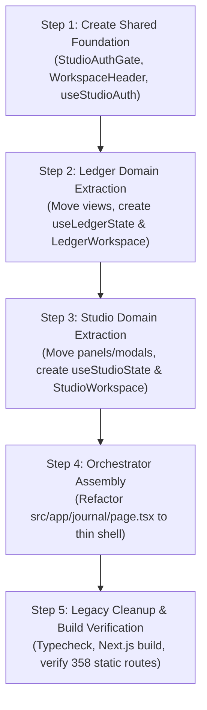

# Phase 2 Refactoring Plan: Domain Separation
**Platform:** Rock The Western World  
**Date:** October 2026  
**Document:** PHASE_2_REFACTOR_PLAN.md  
**Status:** Architecture Proposal • Awaiting User Approval  

---

## 1. Executive Summary & Architectural Objectives

The current journal/editorial workspace is concentrated inside a single monolithic client component: `src/app/journal/page.tsx` (2,384 lines, 33 `useState` hooks). This single file simultaneously manages:
1. **The Ledger Domain:** Private temporal horizon planning (Daily check-ins, Weekly rhythms, Monthly horizons, Annual Compass), habit matrix heatmaps, energy quadrant selections, Wikipedia "On This Day" lookups, and private log auto-saving.
2. **The Editorial Studio Domain:** Public-facing broadsheet essay drafting, cultural review metadata panels (Book/Comic/Record/Podcast reviews), desk taxonomy selection, TipTap WYSIWYG synchronization, social media card generation, dispatch newsletter queueing, and public promotion workflows.

### Objectives
- **Strict Domain Separation:** Deconstruct the monolith into two clean, self-contained feature packages: `src/features/ledger` and `src/features/studio`, with common UI/auth encapsulated in `src/features/shared`.
- **Maintain Full Feature Parity:** 100% of existing functionality, keyboards shortcuts, auto-save timers, templates, and view modes must remain identical.
- **Preserve All Existing Routes:** The canonical route `/journal` remains unchanged. No redirect loops or route breaking.
- **Preserve All User Workflows:** Workflow muscle-memory, button placements, auto-save indicators, and visual styling (Passion Amber `#B45309` vs. Studio Blue `#1E40AF`) remain pixel-identical.
- **Zero Database Schema Changes:** Preserves all Supabase tables (`entries`, `subscribers`, `trophy_books`) and existing data models.
- **Minimal Regression Risk:** Phased migration sequence where each step is independently verifiable with `npm run build` (TypeScript compiler) before proceeding.

---

## 2. Proposed Directory Structure & File Migration Plan

### 2.1 File Move & Allocation Matrix

| Source Path (Current) | Target Path (Phase 2) | Domain | Status / Action |
|:---|:---|:---|:---|
| `src/components/journal/ledger/CompassRoadmapView.tsx` | `src/features/ledger/components/CompassRoadmapView.tsx` | Ledger | Move directly |
| `src/components/journal/ledger/MonthlyHorizonView.tsx` | `src/features/ledger/components/MonthlyHorizonView.tsx` | Ledger | Move directly |
| `src/components/journal/ledger/WeeklyRhythmView.tsx` | `src/features/ledger/components/WeeklyRhythmView.tsx` | Ledger | Move directly |
| `src/components/journal/ledger/DailyLedgerView.tsx` | `src/features/ledger/components/DailyLedgerView.tsx` | Ledger | Move directly |
| `src/components/journal/ledger/LedgerHierarchyTree.tsx` | `src/features/ledger/components/LedgerHierarchyTree.tsx` | Ledger | Move directly |
| `src/components/journal/ledger/LedgerHorizonNav.tsx` | `src/features/ledger/components/LedgerHorizonNav.tsx` | Ledger | Move directly |
| `src/components/journal/ReflectionPromptBar.tsx` | `src/features/ledger/components/ReflectionPromptBar.tsx` | Ledger | Move directly |
| `src/components/journal/DailyPersonalLedger.tsx` | `src/features/ledger/components/legacy/DailyPersonalLedger.tsx` | Ledger | Deprecated prototype (archive) |
| *New* | `src/features/ledger/hooks/useLedgerState.ts` | Ledger | Extracted custom state hook |
| *New* | `src/features/ledger/LedgerWorkspace.tsx` | Ledger | Top-level Ledger boundary component |
| *New* | `src/features/ledger/types.ts` | Ledger | Domain types & re-exports |
| `src/components/journal/TipTapEditor.tsx` | `src/features/studio/components/TipTapEditor.tsx` | Studio | Move directly |
| `src/components/journal/ReviewCraftPanel.tsx` | `src/features/studio/components/ReviewCraftPanel.tsx` | Studio | Move directly |
| `src/components/journal/EditorialPhotographyAccordion.tsx` | `src/features/studio/components/EditorialPhotographyAccordion.tsx` | Studio | Move directly |
| `src/components/journal/SocialPublishingStudio.tsx` | `src/features/studio/components/SocialPublishingStudio.tsx` | Studio | Move directly |
| `src/components/journal/MediaRibbon.tsx` | `src/features/studio/components/media/MediaRibbon.tsx` | Studio | Move directly |
| `src/components/journal/OpenAccessImageGallery.tsx` | `src/features/studio/components/media/OpenAccessImageGallery.tsx` | Studio | Move directly |
| `src/components/journal/PromoteModal.tsx` | `src/features/studio/components/modals/PromoteModal.tsx` | Studio | Move directly |
| `src/components/journal/DispatchModal.tsx` | `src/features/studio/components/modals/DispatchModal.tsx` | Studio | Move directly |
| `src/components/journal/AnalyticsModal.tsx` | `src/features/studio/components/modals/AnalyticsModal.tsx` | Studio | Move directly |
| *New* | `src/features/studio/components/StudioSidebar.tsx` | Studio | Extracted Editorial desk drawers |
| *New* | `src/features/studio/hooks/useStudioState.ts` | Studio | Extracted custom state hook |
| *New* | `src/features/studio/StudioWorkspace.tsx` | Studio | Top-level Studio boundary component |
| *New* | `src/features/studio/types.ts` | Studio | Domain types & desk taxonomy |
| `src/components/journal/AuthModal.tsx` | `src/features/shared/components/StudioAuthGate.tsx` | Shared | Refactored into unified login gate |
| *New* | `src/features/shared/components/WorkspaceHeader.tsx` | Shared | Extracted top navigation & mode switch |
| *New* | `src/features/shared/components/SaveStatusBadge.tsx` | Shared | Extracted auto-save status indicator |
| *New* | `src/features/shared/hooks/useStudioAuth.ts` | Shared | Extracted Supabase session hook |
| `src/app/journal/page.tsx` | `src/app/journal/page.tsx` | Shell | Thin orchestrator (~120 lines) |

---

## 3. State Management Extraction Design

### 3.1 Ledger State Hook (`useLedgerState.ts`)
Encapsulates all personal planning, multi-horizon navigation, and habit logic.

```typescript
export interface UseLedgerStateProps {
  userId: string | null;
}

export interface UseLedgerStateReturn {
  // Navigation & Horizon State
  horizon: LedgerHorizon;
  setHorizon: (h: LedgerHorizon) => void;
  selectedDateKey: string;
  selectedWeekKey: string;
  selectedMonthKey: string;
  selectedYear: number;
  handlePrevPeriod: () => void;
  handleNextPeriod: () => void;
  handleSnapCurrent: () => void;
  handleHorizonChange: (h: LedgerHorizon) => void;
  
  // Document & Content State
  activeEntry: Entry | null;
  title: string;
  setTitle: (t: string) => void;
  contentHtml: string;
  setContentHtml: (html: string) => void;
  metadata: EntryMetadata;
  updateMetadata: (newMeta: Partial<EntryMetadata>) => void;
  saveStatus: 'saved' | 'saving' | 'unsaved';
  feedbackMessage: string | null;
  
  // Horizon Aggregation Metrics
  monthlyGoalProgress: { done: number; total: number };
  weeklyGoalProgress: { done: number; total: number };
  parentGamechangerTitle?: string;
  parentWeekFocus?: string;
  
  // Archive & Hierarchy Tree
  privateEntries: Entry[];
  selectEntry: (entry: Entry) => void;
  loadHorizonDocument: (horizon: LedgerHorizon, dateKey: string, weekKey: string, monthKey: string, year: number) => Promise<void>;
  handleDeleteEntry: (entry: Entry) => Promise<void>;
  flushDraft: () => void;
}
```

**Key Isolation Guardrails:**
- Auto-save timer strictly targets `status = 'private_log'` and `entry_type = 'personal_ledger'`.
- All draft titles default to `Daily Ledger · [Date]` or horizon-specific keys.
- Completely decouples from desk taxonomies, publishing modals, and Resend broadcast states.

---

### 3.2 Studio State Hook (`useStudioState.ts`)
Encapsulates editorial drafting, desk taxonomy, cultural critique panels, and publishing workflows.

```typescript
export interface UseStudioStateProps {
  userId: string | null;
}

export interface UseStudioStateReturn {
  // Active Article State
  activeEntry: Entry | null;
  title: string;
  setTitle: (t: string) => void;
  contentHtml: string;
  setContentHtml: (html: string) => void;
  entryType: EntryType;
  setEntryType: (type: EntryType) => void;
  entryStatus: EntryStatus;
  selectedDesk: DeskType;
  setSelectedDesk: (desk: DeskType) => void;
  selectedCategory: SubCategory;
  setSelectedCategory: (cat: SubCategory) => void;
  metadata: EntryMetadata;
  updateMetadata: (newMeta: Partial<EntryMetadata>, autoSave?: boolean) => void;
  saveStatus: 'saved' | 'saving' | 'unsaved';
  
  // Drawer / Lists State
  draftEntries: Entry[];
  publishedEntries: Entry[];
  editorialTab: 'drafts' | 'published' | 'all';
  setEditorialTab: (tab: 'drafts' | 'published' | 'all') => void;
  searchFilter: string;
  setSearchFilter: (q: string) => void;
  
  // Actions
  createNewDocument: (type?: EntryType) => void;
  selectEntry: (entry: Entry) => void;
  handleDeleteEntry: (entry: Entry) => Promise<void>;
  handleUnpublishToDraft: () => Promise<void>;
  handleApplyTemplate: (body: string) => void;
  saveCurrentDraft: (overrides?: Partial<EntryMetadata>) => Promise<void>;
  flushDraft: () => void;
  
  // Modals & Overlay Triggers
  isPromoteOpen: boolean;
  setIsPromoteOpen: (open: boolean) => void;
  isDispatchOpen: boolean;
  setIsDispatchOpen: (open: boolean) => void;
  isAnalyticsOpen: boolean;
  setIsAnalyticsOpen: (open: boolean) => void;
}
```

**Key Isolation Guardrails:**
- Auto-save debouncing targets `status = 'draft'` or `status = 'published'`.
- State is completely oblivious to habit heatmaps, compass roadmaps, and Wikipedia historical APIs.

---

### 3.3 Shared Auth Hook (`useStudioAuth.ts`)
Encapsulates Supabase session validation, listener cleanup, author sign-in, and sign-out.

```typescript
export interface UseStudioAuthReturn {
  user: any;
  loading: boolean;
  authError: string | null;
  isSubmitting: boolean;
  signIn: (email: string, pass: string) => Promise<void>;
  signOut: () => Promise<void>;
}
```

---

## 4. Component Architecture & Interfaces

### 4.1 Orchestrator: `src/app/journal/page.tsx` (~120 lines)
The top-level page acts purely as an auth gate and high-level layout shell:

```tsx
'use client';

import { useState, useEffect } from 'react';
import { useStudioAuth } from '@/features/shared/hooks/useStudioAuth';
import { StudioAuthGate } from '@/features/shared/components/StudioAuthGate';
import { WorkspaceHeader } from '@/features/shared/components/WorkspaceHeader';
import { LedgerWorkspace } from '@/features/ledger/LedgerWorkspace';
import { StudioWorkspace } from '@/features/studio/StudioWorkspace';

export default function JournalPage() {
  const { user, loading, authError, isSubmitting, signIn, signOut } = useStudioAuth();
  const [workspaceMode, setWorkspaceMode] = useState<'ledger' | 'editorial'>('ledger');
  const [isSidebarOpen, setIsSidebarOpen] = useState(true);
  const [isFocusMode, setIsFocusMode] = useState(false);

  // Restore workspace preferences
  useEffect(() => {
    try {
      const savedMode = localStorage.getItem('rww_studio_workspace_mode');
      if (savedMode === 'ledger' || savedMode === 'editorial') setWorkspaceMode(savedMode);
      const savedSidebar = localStorage.getItem('rww_studio_sidebar_collapsed');
      if (savedSidebar !== null) setIsSidebarOpen(savedSidebar !== 'true');
    } catch {}
  }, []);

  const handleModeChange = (mode: 'ledger' | 'editorial') => {
    setWorkspaceMode(mode);
    try { localStorage.setItem('rww_studio_workspace_mode', mode); } catch {}
  };

  if (loading) return <StudioLoadingState />;
  if (!user) return <StudioAuthGate onSignIn={signIn} error={authError} isSubmitting={isSubmitting} />;

  return (
    <div className="min-h-screen bg-[#FAF8F5] text-[#1C1917] flex flex-col antialiased">
      <WorkspaceHeader
        workspaceMode={workspaceMode}
        onModeChange={handleModeChange}
        isSidebarOpen={isSidebarOpen}
        onToggleSidebar={() => setIsSidebarOpen((prev) => !prev)}
        isFocusMode={isFocusMode}
        onToggleFocusMode={() => setIsFocusMode((prev) => !prev)}
        onSignOut={signOut}
        userEmail={user.email}
      />

      {workspaceMode === 'ledger' ? (
        <LedgerWorkspace
          userId={user.id}
          isSidebarOpen={isSidebarOpen}
          isFocusMode={isFocusMode}
          onCloseMobileSidebar={() => setIsSidebarOpen(false)}
        />
      ) : (
        <StudioWorkspace
          userId={user.id}
          isSidebarOpen={isSidebarOpen}
          isFocusMode={isFocusMode}
          onCloseMobileSidebar={() => setIsSidebarOpen(false)}
        />
      )}
    </div>
  );
}
```

---

## 5. Step-by-Step Migration Sequencing

To minimize regression risk and preserve working software at every stage, the refactor will execute across 5 granular, verifiable phases:



### Phase A: Shared Foundation (`src/features/shared/`)
1. Create `src/features/shared/hooks/useStudioAuth.ts`.
2. Create `src/features/shared/components/StudioAuthGate.tsx` (preserving the exact styling of the current confidential atelier login view).
3. Create `src/features/shared/components/SaveStatusBadge.tsx` (reusable saving indicator).
4. Create `src/features/shared/components/WorkspaceHeader.tsx` (logo, mode switch, sidebar toggle, user dropdown).
5. **Verification Checkpoint A:** Run `npx tsc --noEmit` to confirm zero compilation errors in shared modules.

### Phase B: Ledger Domain Extraction (`src/features/ledger/`)
1. Move components from `src/components/journal/ledger/` into `src/features/ledger/components/`.
2. Move `src/components/journal/ReflectionPromptBar.tsx` into `src/features/ledger/components/`.
3. Create `src/features/ledger/hooks/useLedgerState.ts` containing the ledger date math, horizon state, and Supabase private log sync.
4. Create `src/features/ledger/LedgerWorkspace.tsx` encapsulating the Ledger sidebar (`LedgerHierarchyTree`) and the 4 horizon canvas views.
5. Create `src/features/ledger/index.ts` exporting `<LedgerWorkspace>`.
6. **Verification Checkpoint B:** Run `npx tsc --noEmit` to confirm Ledger domain compiles cleanly.

### Phase C: Editorial Studio Domain Extraction (`src/features/studio/`)
1. Move `TipTapEditor.tsx`, `ReviewCraftPanel.tsx`, `EditorialPhotographyAccordion.tsx`, `SocialPublishingStudio.tsx` into `src/features/studio/components/`.
2. Move modals (`PromoteModal.tsx`, `DispatchModal.tsx`, `AnalyticsModal.tsx`) into `src/features/studio/components/modals/`.
3. Move media galleries (`MediaRibbon.tsx`, `OpenAccessImageGallery.tsx`) into `src/features/studio/components/media/`.
4. Create `src/features/studio/components/StudioSidebar.tsx` encapsulating the draft/published drawers and search filter.
5. Create `src/features/studio/hooks/useStudioState.ts` containing draft creation, desk taxonomy, review templates, and editorial auto-save.
6. Create `src/features/studio/StudioWorkspace.tsx` encapsulating the sidebar, canvas, format ribbon, review panels, TipTap editor, and promotion modals.
7. Create `src/features/studio/index.ts` exporting `<StudioWorkspace>`.
8. **Verification Checkpoint C:** Run `npx tsc --noEmit` to confirm Studio domain compiles cleanly.

### Phase D: Orchestrator Assembly (`src/app/journal/page.tsx`)
1. Replace the 2,384-line monolith in `src/app/journal/page.tsx` with the thin, typed orchestrator shell.
2. Ensure URL query parameters or localStorage retain preference (`?mode=ledger` vs `?mode=editorial`).
3. Retain backwards compatibility for any external links.
4. **Verification Checkpoint D:** Run `npx tsc --noEmit` to ensure the orchestrator connects both workspaces seamlessly.

### Phase E: Final Cleanup & Full Regression Suite
1. Archive unused/deprecated prototype files (`DailyPersonalLedger.tsx` -> `legacy/`, `AuthModal.tsx`).
2. Run full Next.js production build: `npm run build`.
3. Verify that all 358 static pages generate cleanly without SSR/hydration warnings.
4. Manually test all interactive workflows in both workspaces:
   - **Ledger:** Daily check-in, habit toggle, triad reflection input, horizon switching (Daily -> Weekly -> Monthly -> Compass), auto-save badge confirmation.
   - **Studio:** Create new essay draft, select desk and subcategory, apply review template (Book/Comic), headline editing, deck editing, TipTap rich text typing, open PromoteModal, open DispatchModal.

---

## 6. Regression Risk Matrix & Mitigation Strategy

| Risk Scenario | Severity | Preventative Architecture & Mitigation |
|:---|:---|:---|
| **Data Loss on Mode Switch** | High | `flushDraft()` handler invoked before switching between Ledger and Editorial workspaces. LocalStorage backup cache retained. |
| **Broken Relative Imports** | Medium | Use canonical Next.js path aliases (`@/features/ledger/*`, `@/features/studio/*`, `@/components/*`). Verification with `tsc --noEmit`. |
| **Accidental Ledger Publication** | High | Strict domain guard: `useLedgerState` only allows `status = 'private_log'` and `entry_type = 'personal_ledger'`. No access to `PromoteModal` from Ledger. |
| **Unsaved TipTap State on Unmount** | Medium | Debounced auto-save hook with unmount flush cleanup via `useEffect` cleanup return. |
| **Styling Discrepancies** | Low | Retain 100% of Tailwind class strings without modification. Zero visual redesign. |

---

## 7. Rollback Plan

All work will be executed on a dedicated refactor branch or clean git checkpoint:
1. Prior to Phase A, the repository state will be committed or tagged (`phase-1-approved`).
2. Each phase (A through E) represents an atomic commit.
3. If any unforeseen regression occurs, reverting the commit immediately restores the monolithic `src/app/journal/page.tsx` without affecting database or build pipelines.

---

## 8. Status & Approval Gate

> [!IMPORTANT]
> **Implementation is paused.**
> No code changes, file moves, or deletions will be initiated until the user reviews and explicitly approves this refactoring plan.
