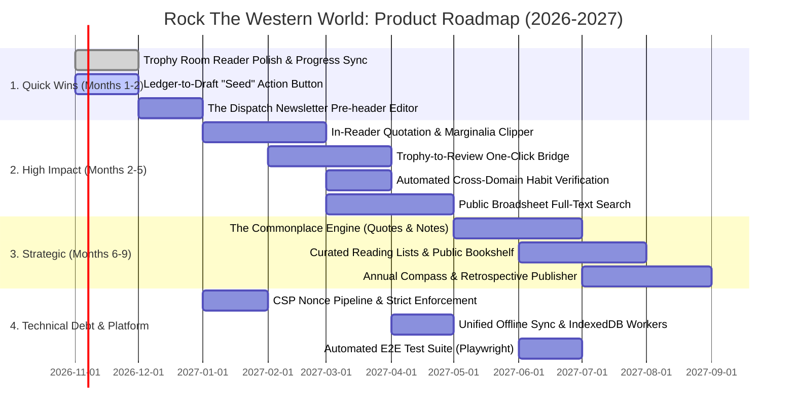

# Product Roadmap (2026–2027)
**Platform:** Rock The Western World  
**Document:** PRODUCT-ROADMAP.md  
**Status:** Authoritative Product Plan  
**Governing Architecture:** ADR-002: Domain Separation Architecture  
**Core Flywheel:** **Read → Reflect → Write → Publish**  

---

## 1. Current State Domain Audit

Following the completion of Phase 1 (Security Hardening & Sanitization) and Phase 2 (Domain Separation), the platform has officially exited stabilization mode. The foundational architecture is now clean, hardened, and partitioned into three distinct domains:

```
┌─────────────────────────────────────────────────────────────────────────┐
│                       ROCK THE WESTERN WORLD                            │
│                         The Literary Flywheel                           │
│                                                                         │
│   [ 1. READ ]      →     [ 2. REFLECT ]   →   [ 3. WRITE ]   → [ 4. PUBLISH ] │
│   Trophy Room               The Ledger           Studio          Broadsheet  │
│  (Vault & Shelf)        (Horizon Planning)    (Editorial CMS)    (Periodical) │
└─────────────────────────────────────────────────────────────────────────┘
```

### 1.1 The Trophy Room (Private Reading Vault)
* **Current Capabilities:**
  * Multi-format in-browser readers: `CbzReader` (comics & manga with RTL/LTR spread rendering), `EpubReader` (reflowable typography with chapter TOC), `PdfReader` (spread and continuous scroll).
  * Hybrid storage pipeline: High-speed cloud streaming via private server route (`/api/trophy/stream-url`) backed by Cloudflare R2; client-side offline caching via Origin Private File System (OPFS) and IndexedDB (Dexie).
  * Library views: Pop-art shelf aesthetics, stacked series decks, list views, and automatic Watchtower sector classification (Comics, Manga, Cookbooks, Reference, Wellness).
* **Current Limitations & Gaps:**
  * **Quote Extraction Void:** No in-reader text selection tool to capture highlights, marginalia, or citations.
  * **Domain Isolation:** Finishing a book in Trophy Room does not automatically check off the "Reading" habit in the Ledger or pre-seed a Book Review in the Studio.
  * **Cover Resolution Fragility:** Legacy fallback covers rely on client-side regex heuristics if embedded metadata is incomplete.

### 1.2 The Ledger (Private Reflection & Multi-Horizon Architecture)
* **Current Capabilities:**
  * Four temporal horizons: Daily Ledger, Weekly Rhythm, Monthly Horizon, and Annual Compass & Roadmap.
  * Daily practices: Habits checklist (Movement, Reading, Writing, Unplug), 4-Quadrant Energy tracking (`High·Focused`, `High·Scattered`, `Low·Reflective`, `Low·Depleted`), and the Daily Triad (`Bright Spot`, `Calibration`, `Working Thought`).
  * Temporal retrospective: Integrated Wikipedia "On This Day" API and "On This Day in Past Memories" multi-year archive query.
  * Rollup metrics: Monthly habit heatmaps, weekly win aggregations, and gamechanger milestone progress percentages.
* **Current Limitations & Gaps:**
  * **Working Thought Silo:** Profound thoughts captured in the Daily Triad remain trapped in private logs; there is no one-click path to promote a working thought into a Broadsheet essay draft.
  * **Manual Habit Ticking:** Reading and writing habits must be checked manually even if the author spent two hours reading in the Trophy Room or drafting in the Studio.
  * **Bi-directional Horizon Cascade:** Subtasks defined in Monthly gamechangers require manual recreation in Weekly task lists.

### 1.3 The Broadsheet & Editorial Studio (Public Publishing Platform)
* **Current Capabilities:**
  * Public periodical: Classical American broadsheet layout, Century-style typography, drop caps, editorial kickers, desk routing (The Commonwealth, The Gallery, The Logbook), RSS/Atom feeds, dynamic OpenGraph image rendering, and newsletter signups.
  * Editorial Studio: Drafts and published drawers, TipTap rich text canvas, Cultural Review Craft panel (Book, Comic, Record, and Podcast structured logs with OpenLibrary and MusicBrainz APIs), Open Access high-resolution art galleries (Met Museum, Chicago Art Institute, Cleveland Museum), and The Dispatch email broadcast modal via Resend.
  * Content sanitization: Server and client HTML sanitization via `isomorphic-dompurify` allowlists.
* **Current Limitations & Gaps:**
  * **Review Data Disconnect:** Writing a book review in the Studio requires searching OpenLibrary from scratch, even if the book exists in the Trophy Room with rich metadata.
  * **Newsletter Customization:** The Dispatch broadcast sends raw article HTML, lacking an editorial "Letter from the Editor" preamble or curated pull quotes.
  * **Search & Reader Discovery:** The public broadsheet lacks full-text search across historical articles and tagged thematic series.

---

## 2. The 6–12 Month Product Roadmap



---

## 3. Roadmap Initiatives by Category

### Category A: Quick Wins (Months 1–2)
*Low engineering complexity, immediate ergonomic payoff for author workflows.*

1. **"Seed to Essay" Button in Ledger Triad:**
   - **Feature:** Add a subtle "Promote to Draft" feather icon next to the Daily Triad's `Working Thought` and `Bright Spot` fields.
   - **Workflow:** Clicking creates a fresh draft in the Editorial Studio pre-populated with the thought as an epigraph or prompt, linking back to the origin date.
   - **Domain Bridge:** Ledger → Studio.

2. **The Dispatch Pre-Header & Personal Note Field:**
   - **Feature:** Enhance `DispatchModal.tsx` to include an optional "Author Note" textarea that renders as a distinctive italicized preamble in the email broadcast without modifying the canonical broadsheet article.
   - **Domain Bridge:** Studio → Broadsheet Subscribers.

3. **Trophy Room Reading Progress Badge in Ledger:**
   - **Feature:** Display the currently active book or comic title and progress percentage directly inside the Daily Ledger's reading section.
   - **Domain Bridge:** Trophy Room → Ledger.

4. **Public Article Reading Progress Indicator:**
   - **Feature:** Add a minimalist, elegant hairline progress bar at the top of `[slug]/page.tsx` for long-form essays (>2,000 words).
   - **Domain Bridge:** Broadsheet UX.

---

### Category B: High-Impact Improvements (Months 2–5)
*Directly unblocks and reinforces the Read → Reflect → Write → Publish flywheel.*

1. **In-Reader Marginalia & Quote Clipper:**
   - **Feature:** In `CbzReader`, `EpubReader`, and `PdfReader`, allow text selection (or area selection for comics) with a contextual popover: *"Copy Quote"*, *"Send to Daily Ledger"*, or *"Send to Studio Draft"*.
   - **Workflow:** Selected excerpts automatically copy with formatted citations (Title, Author, Chapter/Page) and append to Today's Ledger check-in notes.
   - **Domain Bridge:** Trophy Room → Ledger / Studio.

2. **Trophy-to-Review One-Click Bridge:**
   - **Feature:** In the Trophy Room metadata drawer or completion screen, add a *"Log Review in Broadsheet Studio"* button.
   - **Workflow:** Instantly opens Editorial Studio with `entry_type = 'book_review'` or `'comic_review'`, pre-filling cover art, author, publisher, ISBN, page count, and reading completion timestamp.
   - **Domain Bridge:** Trophy Room → Studio.

3. **Automated Cross-Domain Habit Verification:**
   - **Feature:** If a session is detected in Trophy Room (>15 minutes of reading) or Studio (>200 words drafted in TipTap), the Daily Ledger automatically flags `habits.reading = true` and `habits.writing = true` with a gentle confirmation indicator.
   - **Domain Bridge:** Trophy Room & Studio → Ledger.

4. **Public Periodical Full-Text Search & Topic Index:**
   - **Feature:** Add a lightweight, privacy-focused client/edge search index for the public broadsheet allowing readers to search essays by topic, desk, cultural review subject, or keyword.
   - **Domain Bridge:** Broadsheet.

---

### Category C: Strategic Initiatives (Months 6–9)
*Major capability expansions establishing the platform as an elite literary workstation.*

1. **The Commonplace Engine (Digital Zettelkasten):**
   - **Feature:** A dedicated cross-domain repository for captured quotations, literary fragments, research citations, and recurring motifs.
   - **Capabilities:**
     - Tag quotes by theme (e.g., *Constitutionalism*, *Aesthetics*, *Americana*).
     - Drag-and-drop quotes directly from the Commonplace drawer into the TipTap editor canvas while writing essays.
   - **Domain Bridge:** Trophy Room (Input) → Commonplace Vault → Studio / Broadsheet (Output).

2. **Public Curated Bookshelf ("What Dan is Reading"):**
   - **Feature:** Allow author to toggle `is_public_shelf = true` on select Trophy Room books.
   - **Capabilities:**
     - Renders an elegant public `/library` or `/shelf` page on the Broadsheet displaying current books, finished dates, and links to published reviews.
   - **Domain Bridge:** Trophy Room → Broadsheet.

3. **Annual Compass & Literary Retrospective Publisher:**
   - **Feature:** At the conclusion of a calendar year, synthesize the Compass roadmap, monthly habit heatmaps, books completed, and essays published into a private or publishable "Annual Literary Report".
   - **Domain Bridge:** Trophy Room + Ledger + Broadsheet Synthesis.

---

### Category D: Technical Debt & Platform Hardening
*Continuous architectural hygiene to preserve maintainability and performance.*

1. **Dynamic CSP Nonce Middleware:**
   - **Objective:** Graduate `Content-Security-Policy-Report-Only` to full `Content-Security-Policy` enforcement mode by generating cryptographically secure request nonces in Next.js middleware for inline hydration scripts.
   - **Target:** Q1 2027.

2. **Web Worker Offloading for EPUB/CBZ Unzipping:**
   - **Objective:** Move client-side extraction of multi-megabyte CBZ archives and EPUB containers off the main UI thread into dedicated Web Workers to eliminate frame drops on lower-powered devices.
   - **Target:** Q2 2027.

3. **Comprehensive End-to-End Test Suite (Playwright):**
   - **Objective:** Automated regression test suite covering:
     - Auth gating and session restoration.
     - Multi-horizon ledger switching and auto-save debouncing.
     - TipTap rich text typing and review craft template injection.
     - Trophy Room reader launch and progress tracking.
   - **Target:** Q2 2027.

4. **Optimized LocalStorage-to-IndexedDB Ledger Cache:**
   - **Objective:** Migrate `rww_local_entries` from `localStorage` (which has a 5MB browser quota) into Dexie/IndexedDB, ensuring decades of daily ledger entries can be stored offline without quota errors.
   - **Target:** Q3 2027.

---

### Category E: Future Vision (Months 10–12 and Beyond)
*The ultimate destination for Rock The Western World.*

1. **The Ambient Reading Room:**
   - Distraction-free, full-screen reading mode that couples typography with optional ambient white noise or low-fidelity soundscapes tailored to the reading sector.
2. **Offline-First PWA Packaging:**
   - Full Progressive Web App manifest enabling the author to read entire graphic novel runs on an airplane or draft essays completely detached from the internet, with seamless bi-directional cloud synchronization upon reconnection.
3. **Syndicated Print Edition Compiler (PDF Broadsheet):**
   - Automated layout engine that formats the quarterly top essays into a printable, classic 2-column or 3-column newspaper broadsheet PDF suitable for archival or physical printing.

---

## 4. Prioritization Matrix (Flywheel Alignment)

| Initiative | Category | Impact | Complexity | Flywheel Stage |
|:---|:---|:---:|:---:|:---|
| **Seed to Essay Button** | Quick Win | High | Low | Reflect → Write |
| **The Dispatch Personal Note** | Quick Win | Medium | Low | Write → Publish |
| **Trophy Progress in Ledger** | Quick Win | Medium | Low | Read → Reflect |
| **In-Reader Quote Clipper** | High Impact | Critical | Medium | Read → Reflect / Write |
| **Trophy-to-Review Bridge** | High Impact | High | Medium | Read → Write |
| **Automated Habit Verification** | High Impact | High | Medium | Read / Write → Reflect |
| **Public Broadsheet Search** | High Impact | High | Medium | Publish (Reader Discovery) |
| **The Commonplace Engine** | Strategic | Critical | High | Read → Reflect → Write |
| **Public Bookshelf** | Strategic | High | Medium | Read → Publish |
| **CSP Nonce Enforcement** | Tech Debt | High | Medium | Security Infrastructure |
| **IndexedDB Ledger Cache** | Tech Debt | High | Medium | Data Durability |
| **Print Edition Compiler** | Future Vision | Medium | High | Publish (Archival) |

---

## 5. Next Steps & Governance

1. **Review & Prioritize:** Author reviews `PRODUCT-ROADMAP.md` and selects the opening sprint focus (recommended: Category A Quick Wins).
2. **Strict Guardrail:** Feature development will strictly respect the domain separation established in ADR-002:
   - Trophy Room features reside in `src/features/trophy-room/`
   - Ledger features reside in `src/features/ledger/`
   - Studio features reside in `src/features/studio/`
   - Broadsheet features reside in `src/app/[slug]/` and `src/app/page.tsx`
   - Cross-domain integration bridges communicate via well-typed data contracts rather than ad-hoc component coupling.
