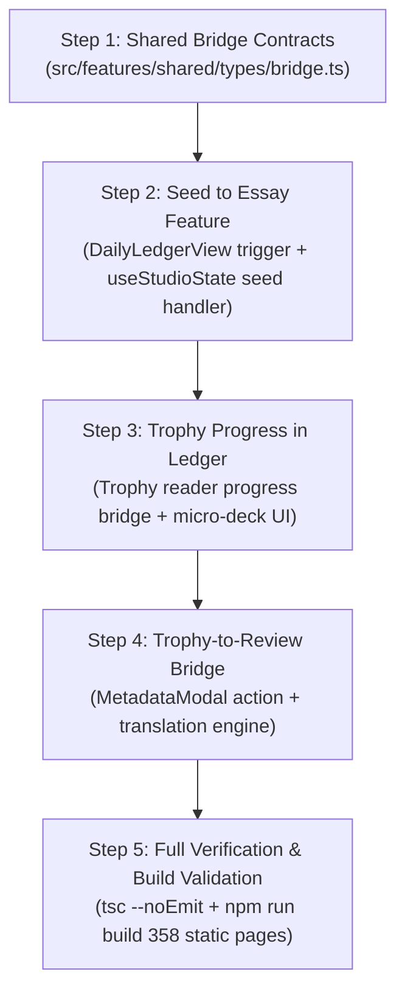

# Sprint 1 Proposal: Strengthening the Literary Flywheel
**Platform:** Rock The Western World  
**Date:** October 2026  
**Document:** SPRINT-1-PROPOSAL.md  
**Status:** Proposal • Awaiting Approval  
**Governing Architecture:** ADR-002 (Domain Separation Architecture)  
**Primary Focus:** **Read → Reflect → Write → Publish**  

---

## 1. Sprint Objective & Executive Summary

With Phase 1 (Security Hardening) and Phase 2 (Domain Separation) completed and verified, the platform has successfully exited stabilization mode. The internal architecture is now cleanly partitioned across three governing domains:
- **The Trophy Room** (`src/features/trophy-room` / `src/components/trophy-room`)
- **The Ledger** (`src/features/ledger`)
- **The Broadsheet & Studio** (`src/features/studio` & `src/app/[slug]`)

**Sprint 1 Goal:** Bridge the three isolated domains into an interconnected, frictionless literary workflow:

```
┌─────────────────────────────────────────────────────────────────────────────┐
│                      SPRINT 1 DOMAIN BRIDGE PIPELINE                        │
│                                                                             │
│  [ TROPHY ROOM ]        →         [ THE LEDGER ]        →      [ STUDIO ]   │
│   (Read Books)                   (Reflect & Plan)            (Write Essays) │
│                                                                             │
│        │                                │                           ▲       │
│        │   Feature 2: Reading Progress  │                           │       │
│        └───────────────────────────────►│   Feature 1: Seed to Essay│       │
│                                         └───────────────────────────┘       │
│        │                                                            ▲       │
│        │                  Feature 3: Trophy-to-Review               │       │
│        └────────────────────────────────────────────────────────────┘       │
└─────────────────────────────────────────────────────────────────────────────┘
```

The sprint delivers three high-value capabilities without compromising domain encapsulation:
1. **Feature 1: "Seed to Essay" Button (Reflect → Write):** Promote a Daily Triad "Working Thought" or "Bright Spot" directly into a fresh Editorial Studio broadsheet draft with one click.
2. **Feature 2: Trophy Reading Progress in Ledger (Read → Reflect):** Display active in-progress books and reading percentages from the Trophy Room directly in the Daily Ledger, linking reading time to habit momentum.
3. **Feature 3: Trophy-to-Review Bridge (Read → Write):** Automatically generate structured cultural review drafts (Books or Comics) in the Editorial Studio from completed Trophy Room volumes with full metadata pre-population.

---

## 2. Feature 1: "Seed to Essay" Button (Reflect → Write)

### 2.1 User Story
> *As an author completing my evening check-in in the Daily Ledger, when I capture a compelling philosophical observation or cultural reflection in my Daily Triad "Working Thought", I want to promote that observation into a Broadsheet essay draft with a single click so that my daily reflections naturally germinate into published writing without manual copy-pasting.*

### 2.2 Domain Ownership & Boundaries
- **Ledger Domain (`src/features/ledger`):**
  - Owns the trigger UI on `DailyLedgerView.tsx` within the Reflection Triad card.
  - Emits a clean event `onSeedToEssay(seed: EssaySeedPayload)` to the parent boundary without knowing anything about TipTap, Desks, or Resend.
- **Studio Domain (`src/features/studio`):**
  - Owns `createSeedDraft(seed: EssaySeedPayload)` on `useStudioState`.
  - Formats the blockquote epigraph, initializes metadata with `seedSource`, and sets the active entry.
- **Orchestrator (`src/app/journal/page.tsx`):**
  - Coordinates the transition: flushes ledger state, invokes `studioState.createSeedDraft()`, switches `workspaceMode` to `'editorial'`, and smooth-scrolls to the headline input.

### 2.3 Data Contract

```typescript
// src/features/shared/types/bridge.ts

export type SeedSourceField = 'working_thought' | 'bright_spot' | 'calibration';

export interface EssaySeedPayload {
  text: string;
  sourceDateKey: string;
  sourceField: SeedSourceField;
  authorNote?: string;
}
```

When accepted by `useStudioState`, the draft is initialized with:
- `title`: `""` (Headline placeholder focused for typing)
- `contentHtml`:
  ```html
  <blockquote class="border-l-2 border-[#B45309] pl-4 italic text-[#44403C] my-4">
    <p>“${seed.text}”</p>
    <cite class="block text-[10px] font-display uppercase tracking-widest text-[#B45309] not-italic mt-2">
      — Daily Ledger · ${formattedDate}
    </cite>
  </blockquote>
  <p></p>
  ```
- `metadata`:
  ```json
  {
    "desk": "commonwealth",
    "category": "Dan Reads the News",
    "isPrivate": false,
    "seedOrigin": {
      "source": "daily_ledger",
      "dateKey": "2026-10-16",
      "field": "working_thought"
    }
  }
  ```

### 2.4 UI / Visual Design
- In [`DailyLedgerView.tsx`](file:///C:/Users/danbi/.gemini/antigravity/scratch/rock-the-western-world/src/features/ledger/components/DailyLedgerView.tsx), inside each Triad block (`Bright Spot`, `Working Thought`), render a subtle action icon in the header when text is present:
  - Button text / tooltip: `"Seed Broadsheet Essay"`
  - Icon: `Feather` (`w-3.5 h-3.5`) in `#1E40AF` (Studio Blue)
  - Hover state: Gentle amber/blue pill transition: `"Seed to Draft →"`

### 2.5 Acceptance Criteria
1. The button only activates / displays when the corresponding Triad field contains at least 3 non-whitespace characters.
2. Clicking the button flushes any pending ledger auto-save without data loss.
3. The workspace automatically transitions to `Editorial CMS` mode with zero page reload.
4. The new draft contains the blockquote epigraph with proper citation and attribution metadata.
5. Returning to the Daily Ledger shows the original Triad text completely intact.

---

## 3. Feature 2: Trophy Reading Progress in Ledger (Read → Reflect)

### 3.1 User Story
> *As a reader and author reflecting on my day in the Daily Ledger, I want to see which book or comic I am currently reading in the Trophy Room and my current page progress right next to my "Reading" habit toggle, so that my personal planning directly reflects my real-world engagement with literature.*

### 3.2 Domain Ownership & Boundaries
- **Trophy Room Domain (`src/lib/trophy/db.ts` & `src/types/trophy.ts`):**
  - Exposes an exported data retriever `getActiveReadingItems(userId?: string): Promise<ReadingDeckItem[]>`.
  - Reads from local IndexedDB (`localProgress`) and queries active items from Supabase `trophy_progress` where `progress_percent > 0` and `progress_percent < 100`.
- **Ledger Domain (`src/features/ledger`):**
  - Receives `activeReadingItems?: ReadingDeckItem[]` via `useLedgerState` / `DailyLedgerView`.
  - Renders the "Currently Reading" micro-deck directly below the Daily Habit Rail.
  - Tapping the item provides an option to open the Trophy Room reader or mark reading time.

### 3.3 Data Contract

```typescript
// src/features/shared/types/bridge.ts

export interface ReadingDeckItem {
  bookId: string;
  title: string;
  series?: string;
  issueNumber?: number;
  format: 'cbz' | 'epub' | 'pdf';
  currentPage: number;
  totalPages: number;
  progressPercent: number;
  coverUrl?: string | null;
  lastReadAt?: string;
}
```

### 3.4 UI / Visual Design
- Inside [`DailyLedgerView.tsx`](file:///C:/Users/danbi/.gemini/antigravity/scratch/rock-the-western-world/src/features/ledger/components/DailyLedgerView.tsx), directly underneath the `Reading` habit pill:
  - If no book is currently in progress: Displays subtle empty state: `"No active reading in Trophy Room · Explore Vault →"`
  - If a book is in progress: Renders an elegant micro-card with:
    - 32x44px typographic cover thumbnail
    - Series & title: `"Saga #54"` or `"Democracy in America"`
    - Progress text: `"Page 42 of 64 · 65%"`
    - Micro progress bar with amber fill (`#B45309`)
    - Action: Clicking navigates to `/trophy-room` with the reader opened.

### 3.5 Acceptance Criteria
1. Reading progress updates in Trophy Room (via OPFS or cloud sync) reflect immediately upon loading the Daily Ledger.
2. Only books with `progress_percent > 0` and `< 100` appear in the active deck, sorted by most recently read.
3. If the author advances reading progress on the current date, the `Reading` habit checkbox in Daily Ledger automatically reflects as completed.
4. Fallback covers render cleanly without image layout shift.

---

## 4. Feature 3: Trophy-to-Review Bridge (Read → Write)

### 4.1 User Story
> *As a cultural critic finishing a graphic novel or book in the Trophy Room, I want a "Write Broadsheet Review" button on the book's details sheet that automatically launches the Editorial Studio with the Book or Comic Review template pre-filled with cover art, author, publisher, and ISBN, so that I can draft my critique immediately upon finishing.*

### 4.2 Domain Ownership & Boundaries
- **Trophy Room Domain (`src/components/trophy-room/shelf/MetadataModal.tsx` & reader completion screen):**
  - Adds a prominent action button: `"Write Broadsheet Review"`.
  - Invokes `bridgeToReview(book: TrophyBook)`.
- **Bridge Utility (`src/features/shared/lib/reviewBridge.ts`):**
  - Pure function mapping `TrophyBook` → `EntryMetadata` and setting up the editorial payload.
- **Studio Domain (`src/features/studio`):**
  - Handles route parameter or bridge payload `/journal?mode=editorial&reviewBookId=...`.
  - Creates a pre-populated draft with `entry_type = 'book_review'` or `'comic_review'`.

### 4.3 Data Contract & Field Translation Engine

```typescript
// src/features/shared/lib/reviewBridge.ts

export function trophyBookToReviewMetadata(book: TrophyBook): {
  entryType: EntryType;
  selectedDesk: DeskType;
  selectedCategory: SubCategory;
  title: string;
  metadata: EntryMetadata;
} {
  const isComicOrManga = book.format === 'cbz' || book.medium === 'comic' || book.medium === 'manga';
  const entryType: EntryType = isComicOrManga ? 'comic_review' : 'book_review';
  const selectedDesk: DeskType = isComicOrManga ? 'gallery' : 'logbook';
  const selectedCategory: SubCategory = isComicOrManga ? 'Off the Comic Rack' : 'A Literal Corner';

  const defaultTitle = book.series
    ? `Review: ${book.series} ${book.issue_number ? `#${book.issue_number}` : ''}`
    : `Review: ${book.title}`;

  return {
    entryType,
    selectedDesk,
    selectedCategory,
    title: defaultTitle,
    metadata: {
      desk: selectedDesk,
      category: selectedCategory,
      title: book.title,
      series: book.series || undefined,
      author: book.author || undefined,
      illustrator: book.illustrator || undefined,
      publisher: book.publisher || undefined,
      year: book.published_year ? String(book.published_year) : undefined,
      isbn: book.isbn || undefined,
      pageCount: book.page_count ? String(book.page_count) : undefined,
      rating: book.rating || 4,
      coverUrl: book.cover_url || undefined,
      cover_image_url: book.cover_url || undefined,
      isPrivate: false,
      trophyBookId: book.id,
    },
  };
}
```

### 4.4 UI / Visual Design
- In [`MetadataModal.tsx`](file:///C:/Users/danbi/.gemini/antigravity/scratch/rock-the-western-world/src/components/trophy-room/shelf/MetadataModal.tsx), in the modal footer next to the "Save Metadata" button:
  - Button text: `"Draft Broadsheet Review"`
  - Styling: Pop-art black & amber button with `Feather` icon
  - On Click: Opens `/journal?mode=editorial&fromTrophy=${book.id}` in author workspace.

### 4.5 Acceptance Criteria
1. Clicking "Draft Broadsheet Review" preserves all entered metadata without losing recent changes.
2. Correctly classifies CBZ/comics into `'comic_review'` under `THE GALLERY → Off the Comic Rack` and EPUB/PDF books into `'book_review'` under `THE LOGBOOK → A Literal Corner`.
3. Pre-populates all available fields in `ReviewCraftPanel` (Cover URL, Author, Publisher, Year, ISBN, Star Rating).
4. Auto-save properly initializes with `status = 'draft'`.

---

## 5. Architectural Invariants & Risk Mitigation

| Risk Scenario | Severity | Preventative Architecture & Mitigation |
|:---|:---|:---|
| **Circular Dependency between Domains** | High | **Strict Isolation Rule:** Ledger and Trophy Room never import Studio components. All cross-domain data contracts live in `src/features/shared/types/bridge.ts`. |
| **Unsaved Edits Overwritten by Seed/Bridge** | High | Before initializing any new seed or review draft, `flushDraft()` is executed synchronously on the active workspace. |
| **IndexedDB Quota or Sync Lag** | Low | Reading progress query checks local IndexedDB first with fallback to Supabase `trophy_progress`. |
| **Route Disruption** | Medium | Canonical route remains `/journal`. Bridge navigation uses standard query parameters (`?mode=editorial&seed=...`). |

---

## 6. Implementation Sequencing Plan



Each step will be committed with an atomic git commit and verified with `npx tsc --noEmit` and `npm run build`.

---

## 7. Approval Gate

> [!IMPORTANT]
> **Implementation is paused.**
> No code changes or component modifications will begin until this Sprint 1 proposal is reviewed and approved by the Architecture Review Board / Author.
