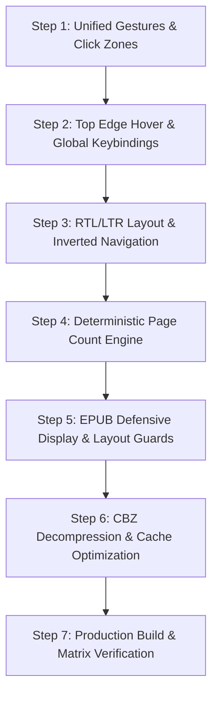

# Trophy Room Reader Polish & Stability Plan

**Document Version:** 1.0.0  
**Status:** Pending Review  
**Date:** October 16, 2026  
**Environment:** Production (`https://rockthewesternworld.com/trophy-room`)  
**Scope:** Remediation of 5 post-recovery reader regressions across CBZ, EPUB, and PDF engines. Feature 2 and Feature 3 remain strictly paused.

---

## Executive Summary

Following the restoration of static export (`42f11b7`), R2 path-style URLs (`dba84e2`), vault sync unblocking (`c47b46d`), and multi-stream download acceleration (`0333df7`), the Trophy Room is functional: books download and open, and the vault sync screen no longer hangs. 

However, user testing identified 5 regressions that hinder reading experience:
1. **Header/Navigation cannot be restored** once hidden, trapping desktop/mouse users.
2. **RTL/LTR reading mode toggle** produces no observable change.
3. **Page counts do not update** during navigation (often frozen at 1/100 or 1/1).
4. **EPUB reader crashed** on initial open of large manga titles (*Blue Period Vol. 4*).
5. **Reader performance feels sluggish** during decompression and archive mounting.

This plan details the root causes and delivers a phased, concrete engineering specification to resolve all 5 issues.

---

## Root Cause Analysis Matrix

| Issue | Severity | Affected Readers | Root Cause |
|---|---|---|---|
| **1. Header/Nav Cannot Be Restored** | High | CBZ, EPUB, PDF | `useSwipeGestures.ts` only listens to `touchstart`/`touchmove`/`touchend` events. There are **zero mouse or pointer event handlers**. Desktop clicks do nothing. In `EpubReader.tsx`, the rendition `<iframe>` swallows clicks without bubbling to parent DOM. Once the 4.5s auto-hide timer expires, desktop users are permanently trapped. |
| **2. RTL/LTR Reading Mode Ineffective** | Critical | CBZ, EPUB, PDF | In `CbzReader.tsx`, `isRtl` is missing from `syncBuffer`'s dependency array. In single-page mode, switching direction does not alter the displayed page. In `EpubReader.tsx`, `readingDirection` is completely ignored by `rendition`. In `ReaderHUD.tsx`, the scrubber slider lacks `dir="rtl"` styling. No visual confirmation toast/badge confirms the switch. |
| **3. Page Counts Do Not Update** | High | CBZ, EPUB | In `EpubReader.tsx`, `book.locations.generate(1024)` is asynchronous and stalls or fails on large image-heavy EPUBs, leaving `locations.length()` at 0 so `currentPage` defaults to 1 and `totalPages` to 100. In `CbzReader.tsx`, `totalPages` initializes from `book.page_count` (often 0 or 1) and stale state closures in `handlePageChange` overwrite the archive's actual page count. |
| **4. EPUB Reader Crash on First Open** | Medium | EPUB (*Blue Period Vol. 4*) | Large manga EPUBs (~155 MB) allocate massive ArrayBuffers. `rendition.display(initialCfi)` throws if `viewerRef.current` has not finished DOM layout (0x0 dimensions) or if `initialCfi` is unindexed. Missing fallback to `rendition.display()` crashes the reader into an error boundary. |
| **5. Sluggish Reader Responsiveness** | Medium | CBZ, EPUB | In `CbzReader.tsx`, JSZip decompressions (`entry.file.async('arraybuffer')`) run on the main UI thread; requesting 4 pages simultaneously during spread transitions creates 400–800ms main thread freezes. Concurrently, `saveBookToOpfs` performs 200MB unthrottled writes during archive mount. |

---

## Phase 1: RTL / LTR Reading Mode Engine (Critical Priority)

### 1.1 Bidirectional State & Layout Coupling
- **File:** `src/components/trophy-room/readers/ReaderContainer.tsx`
  - Ensure `effectiveSettings.readingDirection` propagates reactively to all reader components.
  - When direction changes, emit a visual HUD toast notification:
    - `"⛩️ Manga Mode: Right-to-Left (Tapping Left advances page)"`
    - `"🦸 Western Comic Mode: Left-to-Right (Tapping Right advances page)"`
  - Persist direction changes immediately to `localStorage` (`rww_trophy_settings`) and update Supabase book metadata (`reading_direction`).

### 1.2 CBZ Bidirectional Spread & Navigation
- **File:** `src/components/trophy-room/readers/CbzReader.tsx`
  - Add `isRtl` to `syncBuffer` dependency array.
  - In single-page mode, display a direction indicator arrow pill in the corner when HUD is toggled or when direction is changed.
  - In dual-page mode:
    - **LTR:** Left Page = $N$, Right Page = $N + 1$.
    - **RTL:** Right Page = $N$, Left Page = $N + 1$.
  - Navigation mapping:
    - **LTR:** Next Page = Arrow Right, Key D, Tap Right 25%, Swipe Left.
    - **RTL:** Next Page = Arrow Left, Key A, Tap Left 25%, Swipe Right.
  - Fix dual-page page stepping: in RTL mode, navigating forward properly steps through even/odd pairs according to cover offset rules.

### 1.3 EPUB Bidirectional Rendition
- **File:** `src/components/trophy-room/readers/EpubReader.tsx`
  - Pass `direction: isRtl ? 'rtl' : 'ltr'` into `book.renderTo()` options.
  - Invert navigation keys and swipe handlers based on `isRtl`:
    ```typescript
    const goForward = isRtl ? prevPage : nextPage;
    const goBackward = isRtl ? nextPage : prevPage;
    ```

### 1.4 Scrubber Progress Reversal
- **File:** `src/components/trophy-room/readers/ReaderHUD.tsx`
  - Set `dir={isRTL ? 'rtl' : 'ltr'}` on the slider container so progress fills from right to left in RTL mode.
  - Align chevron controls: Left Chevron advances in RTL; Right Chevron retreats.

---

## Phase 2: Reader Header & Navigation Restoration (High Priority)

### 2.1 Unified Pointer & Click Zone Architecture
- **File:** `src/hooks/useSwipeGestures.ts`
  - Extend gesture system to listen to both touch (`touchstart`, `touchend`) and pointer/mouse (`click`, `pointerup`) events.
  - Partition reader viewport into three interaction zones:
    - **Left Zone (0% – 25%):** Previous page in LTR / Next page in RTL.
    - **Center Zone (25% – 75%):** Toggle HUD visibility (`toggleHUD()`).
    - **Right Zone (75% – 100%):** Next page in LTR / Previous page in RTL.
  - Prevent conflict between drag/pan actions and tap/click triggers by verifying mouse movement distance is $< 10\text{px}$.

### 2.2 Top Edge Hover Trigger (Desktop Rescue)
- **File:** `src/components/trophy-room/readers/ReaderContainer.tsx`
  - Implement a transparent `h-8` hover sensor at the top edge of the screen (`fixed top-0 left-0 right-0 z-40`).
  - When mouse enters this zone (`onMouseEnter`), immediately reveal the HUD and reset the auto-hide timer.
  - Keep HUD visible while mouse pointer is within either the Header or Footer.

### 2.3 EPUB Iframe Click Interception
- **File:** `src/components/trophy-room/readers/EpubReader.tsx`
  - Register click and mousemove listeners directly inside the Epub.js rendition iframe:
    ```typescript
    rendition.on('click', (event: MouseEvent) => {
      const width = window.innerWidth;
      const x = event.clientX;
      if (x > width * 0.25 && x < width * 0.75) {
        onToggleHUD();
      } else if (x <= width * 0.25) {
        isRtl ? nextPage() : prevPage();
      } else {
        isRtl ? prevPage() : nextPage();
      }
    });
    ```
  - Forward iframe keyboard events to parent window so navigation keys function seamlessly while iframe is focused.

### 2.4 Universal Global Keyboard Shortcuts
- **File:** `src/components/trophy-room/readers/ReaderContainer.tsx`
  - Centralize keyboard event handling at the container level:
    - `Escape`, `h`, `m`: Toggle HUD.
    - `ArrowRight`, `PageDown`, `Space`: Next Page (LTR) / Previous Page (RTL).
    - `ArrowLeft`, `PageUp`: Previous Page (LTR) / Next Page (RTL).
    - `f`: Toggle Fullscreen.

### 2.5 Floating Discreet HUD Trigger Button
- **File:** `src/components/trophy-room/readers/ReaderHUD.tsx`
  - Add a subtle, semi-transparent toggle indicator at the top-center or top-right of the viewport that remains visible even when the full header is hidden.
  - Clicking this pill restores the HUD immediately.

---

## Phase 3: Accurate Page Count & Progress Pipeline (High Priority)

### 3.1 Instant Deterministic Spine Indexing for EPUB
- **File:** `src/components/trophy-room/readers/EpubReader.tsx`
  - Avoid blocking on `book.locations.generate(1024)` for image-heavy manga.
  - Extract page counts directly from the EPUB spine immediately upon `await book.ready`:
    ```typescript
    const totalPages = book.spine?.length || (book.spine as any)?.spineItems?.length || 1;
    ```
  - On `relocated` event:
    ```typescript
    const spineIndex = location.start.index ?? 0;
    const currentPage = spineIndex + 1;
    const percent = Math.round((currentPage / totalPages) * 100);
    onProgressUpdate(percent, location.start.cfi, currentPage, totalPages);
    ```
  - This guarantees deterministic page counts (e.g. `45 / 192`) on every single page turn from the first frame.

### 3.2 CBZ Archive Page Count Synchronization
- **File:** `src/components/trophy-room/readers/CbzReader.tsx` & `ReaderContainer.tsx`
  - When `indexCbz` determines `imageEntries.length`, emit `onPageChange(startPage, imageEntries.length)` immediately.
  - In `ReaderContainer.tsx`, update `setTotalPages(safeTotal)` and avoid overwriting with stale defaults.
  - In dual-page mode, display active spread in the HUD:
    - `"Pages 4–5 / 206"` instead of a single static number.
  - Persist accurate `total_pages` to Supabase metadata and local storage so subsequent opens have correct totals from millisecond zero.

---

## Phase 4: EPUB Reader Hardening (*Blue Period Vol. 4*) (Medium Priority)

### 4.1 Staged Layout Mounting
- **File:** `src/components/trophy-room/readers/EpubReader.tsx`
  - Before calling `book.renderTo(viewerRef.current)`, verify `viewerRef.current` has non-zero client dimensions (`offsetWidth > 0 && offsetHeight > 0`).
  - If layout is pending, defer render via `requestAnimationFrame`.

### 4.2 Graceful Initial Display Fallback
- **File:** `src/components/trophy-room/readers/EpubReader.tsx`
  - Wrap initial location display in defensive try/catch:
    ```typescript
    try {
      if (initialCfi) {
        await rendition.display(initialCfi);
      } else {
        await rendition.display();
      }
    } catch (cfiError) {
      console.warn('[EpubReader] Failed to restore initial CFI, falling back to book start:', cfiError);
      await rendition.display();
    }
    ```
  - This prevents initial open crashes when a previously saved CFI is invalidated or out of range.

### 4.3 Safe Manga Styling Injection
- For fixed-layout manga EPUBs, avoid overriding SVG viewports or image dimensions with text-oriented CSS (`text-align: justify`, `line-height`). Apply text typography styles only to flowing text items.

---

## Phase 5: Reader Performance Profiling & Optimization (Medium Priority)

### 5.1 Non-Blocking Sequential Pre-Extraction
- **File:** `src/components/trophy-room/readers/CbzReader.tsx`
  - Replace simultaneous `Promise.all` extraction with prioritized queue:
    1. Extract active visible page(s) first.
    2. Render immediately.
    3. Pre-extract next 2 pages in background using `requestIdleCallback` or 50ms interval delays.
  - Eliminates main thread freezes during rapid page flips.

### 5.2 Extended Memory Sliding Window
- **File:** `src/components/trophy-room/readers/CbzReader.tsx`
  - Increase memory retention window from 4 pages to 12 pages.
  - Avoid frequent URL object creation and revocation churn.

### 5.3 Deferred OPFS Persistence
- **File:** `src/components/trophy-room/readers/ReaderContainer.tsx`
  - Delay `saveBookToOpfs(book.id, blob)` by 500ms after initial render using `setTimeout`.
  - Prevents 200MB disk write operations from competing with initial ZIP decompression.

---

## Phase 6: Implementation Sequence



1. **Step 1:** Update `useSwipeGestures.ts` with desktop mouse/pointer click handling and 3-zone partitioning.
2. **Step 2:** Update `ReaderContainer.tsx` and `EpubReader.tsx` with top hover zone, keyboard shortcuts, and iframe click interception.
3. **Step 3:** Implement full RTL/LTR reactivity across `CbzReader.tsx`, `EpubReader.tsx`, and `ReaderHUD.tsx`.
4. **Step 4:** Implement deterministic spine-based page counting in `EpubReader.tsx` and fix page count propagation in `CbzReader.tsx`.
5. **Step 5:** Harden `EpubReader.tsx` with container dimension checks and CFI fallback.
6. **Step 6:** Profile and optimize CBZ pre-extraction sliding window and defer OPFS disk writes.
7. **Step 7:** Run full Next.js static export build and execute regression test matrix across all 3 formats.

---

## Phase 7: Regression Testing Matrix

| ID | Test Title | Format | Size | Priority Criteria | Expected Result |
|---|---|---|---|---|---|
| **T-01** | *Judge Dredd: The Complete Case Files Vol. 1* | CBZ | 206.55 MB | Navigation & Restoration | Header auto-hides after 4.5s; click center or hover top restores header; Arrow keys advance/retreat. |
| **T-02** | *Blue Period Vol. 4* | EPUB | ~155 MB | Initial Open & Stability | Opens on **first attempt** with 0 crashes; deterministic page count (e.g. `Page 1 / 192`); iframe click restores HUD. |
| **T-03** | *Blue Period Vol. 4* | EPUB | ~155 MB | RTL Reading Mode | Switching to RTL sets Right-to-Left progression; tapping left advances; scrubber fills RTL. |
| **T-04** | *The Complete Peanuts 1959–1960* | PDF | ~60 MB | Header & Progress | Header hides and restores on click/hover; page scrubber updates accurately; zoom reset works on double-tap. |
| **T-05** | *2000 AD Sci-Fi Special 2023* | CBZ | ~85 MB | Dual-Page Spread | 2-Page spread displays Pages 2–3, 4–5; RTL mode swaps left/right positions smoothly; no frame freeze. |
| **T-06** | Browser Refresh & Persistence | All | N/A | Progress Preservation | Reading position, direction setting, and spread preferences persist across page reloads. |

---

## Strict Constraints & Directives

1. **Feature 2 (Ledger Reading Progress) and Feature 3 (Bridge to Review Drafts) remain paused.**
2. No implementation code will be written until this stabilization plan is reviewed and approved.
3. Static export (`output: 'export'`) and SiteGround Apache headers (`public/.htaccess`) will remain intact.
