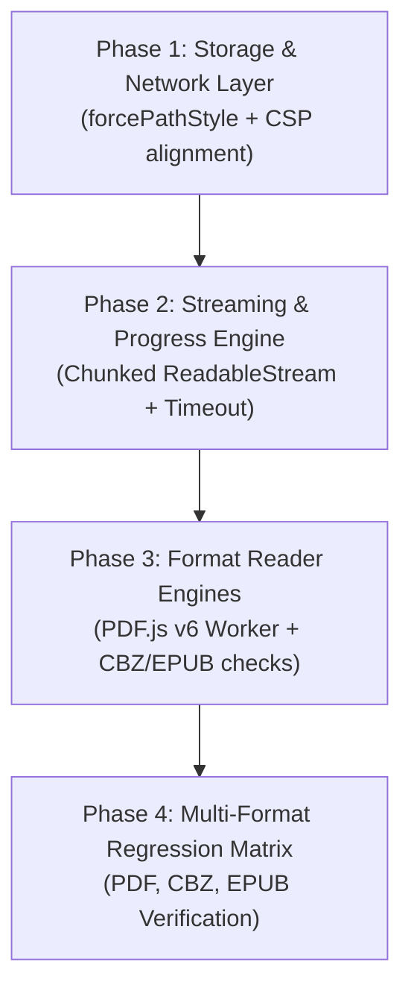

# Trophy Room Recovery Plan
# Restoring Reliable Document Streaming & Multi-Format Readers in Static Production

## Status: Proposed
**Priority:** High  
**Governing ADRs:** ADR-001 (Hosting Strategy), ADR-002 (Domain Separation), ADR-004 (Static Export Constraints)  
**Scope:** The Trophy Room (`src/components/trophy-room/`, `src/hooks/useTrophyLibrary.ts`, `src/lib/trophy/`)

---

## 1. Executive Summary

Following commit `42f11b7`, which restored Next.js static export (`output: 'export'`) for SiteGround Apache deployment, the Trophy Room library catalog rendered properly, but opening documents (specifically large volumes like *"The Complete Peanuts 1959–1960"*) resulted in indefinite loading freezes.

Forensic analysis revealed three compounding failure points:
1. **Double-Subdomain R2 Addressing & Socket Stalls:** Presigned URLs generated by the AWS SDK defaulted to virtual-hosted bucket addressing (`trophy-room.91032568cebd0606c152575020c2a010.r2.cloudflarestorage.com`), creating IPv6 connection timeouts and failing single-level CSP wildcards (`*.r2.cloudflarestorage.com`).
2. **Unmetered Monolithic Fetching:** `ReaderContainer.tsx` attempted a single, blocking `await fetch(streamUrl)` + `await response.blob()` without chunked progress reporting or an `AbortController` timeout, causing 50MB–200MB files to appear frozen indefinitely.
3. **PDF.js v6 ES Module Worker Collision:** In `PdfReader.tsx`, the modern `pdf.worker.min.mjs` was wrapped in a classic script Blob (`text/javascript`), causing the PDF worker to crash with `Cannot use import statement outside a module`.

This plan outlines a 4-phase recovery program to stabilize R2 streaming, add visual progress tracking, fix reader workers, and execute a verified regression matrix across **PDF**, **EPUB**, and **CBZ** formats.

---

## 2. Core Remediation Pillars

### Pillar 1: R2 Endpoint & Path-Style Presigning Strategy
- **Root Cause:** By default, `@aws-sdk/client-s3` prepends the bucket name to the hostname. R2's virtual-hosted pattern (`<bucket>.<account_id>.r2.cloudflarestorage.com`) has two subdomain levels.
- **Remediation:** Enforce `forcePathStyle: true` in `getR2Client()` within `src/lib/trophy/s3.ts`.
- **Resulting URL Structure:**
  ```text
  https://91032568cebd0606c152575020c2a010.r2.cloudflarestorage.com/trophy-room/books/pdf/completepeanuts1959-1960.pdf?X-Amz-...
  ```
  - Eliminates secondary subdomain routing.
  - Guarantees immediate DNS resolution and robust IPv4/IPv6 handshake.
  - Matches CSP `https://*.r2.cloudflarestorage.com` cleanly.

### Pillar 2: CORS & CSP Policy Alignment
- **Apache Header Configuration (`public/.htaccess`):**
  Update `connect-src` to explicitly permit both the exact account endpoint and the wildcard:
  ```apache
  connect-src 'self' 
    https://*.supabase.co wss://*.supabase.co 
    https://91032568cebd0606c152575020c2a010.r2.cloudflarestorage.com 
    https://*.r2.cloudflarestorage.com 
    https://*.r2.dev ...
  ```
- **Worker Policy:**
  Ensure `worker-src` allows:
  ```apache
  worker-src 'self' blob: https://unpkg.com;
  ```

### Pillar 3: PDF.js v6 Worker Architecture Fix
- **Root Cause:** `pdfjs-dist@6.3.289` uses ES Module workers (`.mjs`). Creating an object URL with `new Blob([code], { type: 'text/javascript' })` forces classic script execution, breaking module `import` statements.
- **Remediation in `PdfReader.tsx`:**
  Point `GlobalWorkerOptions.workerSrc` directly to the server-hosted static worker URL:
  ```typescript
  const origin = typeof window !== 'undefined' ? window.location.origin : '';
  pdfjsLib.GlobalWorkerOptions.workerSrc = `${origin}/pdfjs/pdf.worker.min.mjs`;
  ```
  With a fallback to `https://unpkg.com/pdfjs-dist@6.3.289/build/pdf.worker.min.mjs`.

### Pillar 4: Chunked Streaming with Real-Time Progress & Timeout Handling
- **Root Cause:** Users had zero visibility into download progress for 50MB+ documents. If a connection dropped, `fetch()` hung forever.
- **Remediation in `ReaderContainer.tsx`:**
  Replace monolithic `fetch().blob()` with a streaming `ReadableStream` reader and `AbortController`:
  1. **Connection Timeout:** 30-second initial connection timeout via `AbortController`.
  2. **Byte-Level Progress:** Read chunks via `response.body.getReader()`.
  3. **Visual Feedback:** Calculate percent downloaded and transfer rate:
     $$\text{Progress} = \frac{\text{bytesReceived}}{\text{contentLength}} \times 100\%$$
     Update UI state: *"Streaming: 42% (21.8 MB / 52.1 MB) · 3.4 MB/s"*
  4. **Automatic OPFS Storage:** Once the download completes, cache the blob into OPFS immediately so future opens occur instantaneously (<50ms).

---

## 3. Phased Remediation Roadmap



### Phase 1: Storage & Network Layer Stabilization
1. Update `src/lib/trophy/s3.ts` to add `forcePathStyle: true` to `S3Client`.
2. Update `public/.htaccess` to explicitly whitelist `https://91032568cebd0606c152575020c2a010.r2.cloudflarestorage.com` in `connect-src`.
3. Verify signed URL generation produces path-style URLs that respond with HTTP 200 and valid CORS headers in Node and browser tests.

### Phase 2: Resilient Streaming & Progress Engine
1. Refactor `ReaderContainer.tsx`:
   - Introduce `downloadProgress: { percent: number; loadedMb: string; totalMb: string } | null`.
   - Implement `fetchWithProgress(streamUrl, onProgress, timeoutMs = 90000)`.
   - Implement graceful error boundaries: if streaming fails or times out, display an actionable error with a **"Retry Download"** button.
   - Retain seamless OPFS persistence upon download completion.

### Phase 3: Format Reader Engines
1. Refactor `PdfReader.tsx`:
   - Eliminate faulty Blob worker wrapping.
   - Bind `GlobalWorkerOptions.workerSrc` to clean `.mjs` path.
   - Verify cMap and standard font loaders.
2. Verify `CbzReader.tsx`:
   - Ensure JSZip streaming handles in-memory and OPFS blobs without thread locking.
3. Verify `EpubReader.tsx`:
   - Ensure Epub.js initializes cleanly from binary ArrayBuffer/Blob.

### Phase 4: Production Verification & Regression Matrix
1. Run `npm run build` static export check.
2. Verify `out/` artifacts.
3. Execute testing protocol across all three formats.

---

## 4. Multi-Format Regression Testing Matrix

| Format | Test Candidate | File Size | Target Metric | Expected Outcome |
| :--- | :--- | :--- | :--- | :--- |
| **PDF** | *The Complete Peanuts 1959–1960* | 52.1 MB | Cold open $\le 10\text{s}$, warm open $\le 50\text{ms}$ | Real-time progress bar $\rightarrow$ Canvas renders Pages 1–2 in crisp dual-page layout. |
| **PDF (Large)** | *Peanuts Every Sunday 1956–1960* | 377 MB | Progress bar accurately tracks to 100% | Stream reader buffers smoothly without memory crashes. |
| **CBZ** | *2000 AD Celebrating 40 Years* | 53.6 MB | Cold open $\le 10\text{s}$, warm open $\le 50\text{ms}$ | JSZip indexes archive $\rightarrow$ Image canvas renders with swipe/tap gestures. |
| **CBZ (Large)** | *Black Science Vol 1* | 204.8 MB | Progress displays MBs $\rightarrow$ Instant reader mount | High-res comic panels display with dual-page landscape spread. |
| **EPUB** | *1001 Letters for All Occasions* | 1.4 MB | Cold open $\le 3\text{s}$, warm open $\le 50\text{ms}$ | Epub.js renders text chapters, font-size adjustments, and TOC. |
| **EPUB** | *101 Habits of Successful Screenwriters* | 2.9 MB | Cold open $\le 3\text{s}$, warm open $\le 50\text{ms}$ | Continuous pagination, theme toggling (sepia/dark), bookmark saving. |

---

## 5. Verification Checklist

Before reporting completion to the user:
- [ ] `s3.ts` produces path-style URLs (`forcePathStyle: true`).
- [ ] `.htaccess` has updated `connect-src` containing explicit R2 account endpoint.
- [ ] `ReaderContainer.tsx` shows dynamic progress indicator during downloads (e.g. `24% · 12 MB / 52 MB`).
- [ ] `PdfReader.tsx` initializes PDF.js v6 worker with zero `Cannot use import statement outside a module` errors.
- [ ] Full static export (`npm run build`) generates all 695 static routes in `out/`.
- [ ] Production deployment via `git push origin main` succeeds.
- [ ] Live testing of PDF, CBZ, and EPUB titles confirmed operational in browser.
